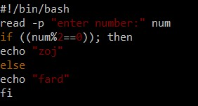
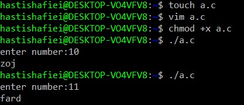
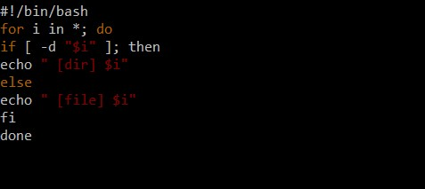
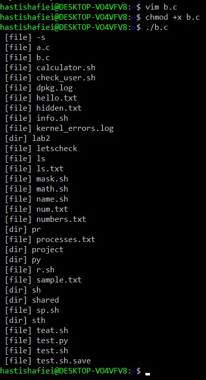

## سوال 1:

اسکریپتی بنویسید که عدد دریافت کرده و زوج یا فرد بودن آن را چاپ کند.

  

## سوال 2:

با ترکیب یک حلقه for و شرط های if اسکریپتی بنویسید که در دایرکتوری فعلی نام تمام فایل هارا با برچسب [file] و دایرکتوری هارا با برچسب [dir]چاپ کند.

