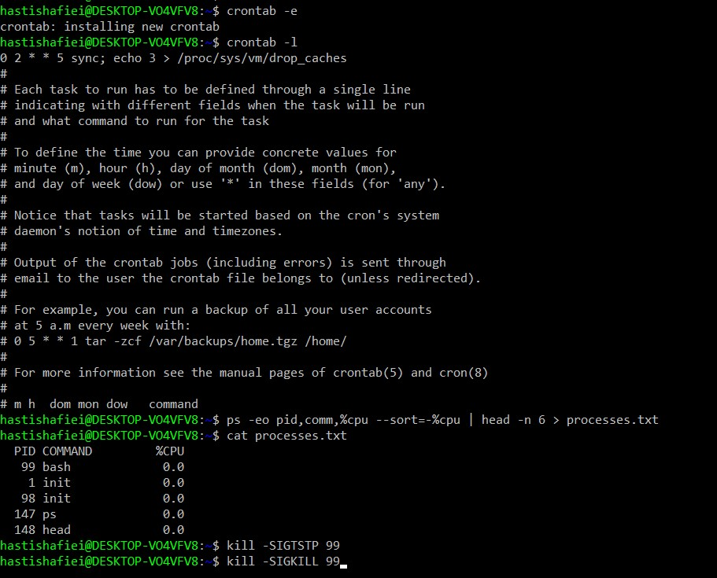

## سوال 1:
<div dir="rtl" align="right">

1-  پیدا کردن 5 فرایند پرمصرف رم با ترکیب PSو هدایت خروجی رم
  
  2-مشاهده محتوای فایلی که ذخیره کردیم
  
  3-فرض کنید PID سنگین ترین فرایند 8899است.SIGTSTP یا توقف موقت

  4-فرایند پاسخ نمیدهد!شلیک نهایی SIGKILL

  5-تنظیم یک کرون جاب برای خالی کردن کش هر جمعه شب ساعت 2
</div>


<div dir="rtl" align="right">

</div>

## سوال 2:
<div dir="rtl" align="right">


### .فرایند زامبی چیست و چرا با kill -9 هم از بین نمیرود؟ 


فرایند زامبی فرایندی است که اجرای آن تمام شده، اما اطلاعات وضعیت خروج آن هنوز در جدول فرایندهای سیستم باقی مانده است.

### ۱. چرا فرایند زامبی ایجاد می‌شود؟

هر فرایند فرزند (Child) یک فرایند والد (Parent) دارد. وقتی فرایند فرزند تمام می‌شود، والد باید با استفاده از تابع `wait()` یا `waitpid()` وضعیت خروج آن را دریافت کند. اگر این کار را انجام ندهد، فرایند فرزند به حالت زامبی درمی‌آید.

### ۲. چرا با kill -9 حذف نمی‌شود؟

دستور `kill -9` فرایندهای در حال اجرا را متوقف می‌کند. اما فرایند زامبی قبلاً اجرای خود را تمام کرده است. بنابراین چیزی برای متوقف کردن وجود ندارد و این دستور نمی‌تواند آن را حذف کند.
`kill -9` نمی‌تواند آن را حذف کند، زیرا دیگر فرایند فعالی وجود ندارد.

</div>

## سوال 3:

<div dir="rtl" align="right">

تحلیل دستور dmesg | grep -i error > kernel-errors.log

ابتدا دستور `dmesg` پیام‌های کرنل را دریافت می‌کند. سپس `grep -i error` پیام‌های حاوی کلمه error را جدا می‌کند. در نهایت، عملگر `>` خروجی را در فایل `kernel-errors.log` ذخیره می‌کند.

</div>

## سوال 4:

<div dir="rtl" align="right">
چرا استفاده از useless use در جامعه لینوکس یک اشتباه معماری محسوب میشود؟

استفاده از Useless Use به معنای اضافه کردن دستورات غیرضروری به یک فرایند است. این کار باعث پیچیدگی کد، کاهش خوانایی و گاهی مصرف منابع بیشتر می‌شود. در فلسفه Unix و Linux بهتر است از ساده‌ترین دستور ممکن برای انجام هر کار استفاده کنیم.
به عنوان مثال:

روش غیرضروری:

```bash
cat file.txt | grep "Linux"
```

روش ساده‌تر:

```bash
grep "Linux" file.txt
```
</div>


