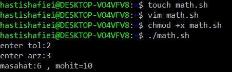
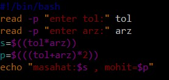
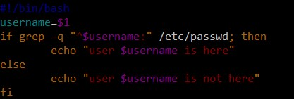
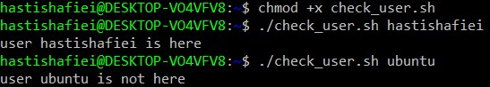

## سوال 1:

 اسکریپتی بنویسید که طول و عرض یک مستطیل را از کاربر بگیرد و محیط و مساحت آن را محاسبه و چاپ کند.

## سوال 2:

  
یک اسکریپت با نام `check_user.sh` بنویسید که یک نام کاربری را به عنوان `$1` (آرگومان خط فرمان) بگیرد.
با استفاده از ابزارهایی مثل `grep` در فایل `/etc/passwd` بررسی کند که آیا این کاربر در سیستم لینوکس وجود دارد یا خیر؟

